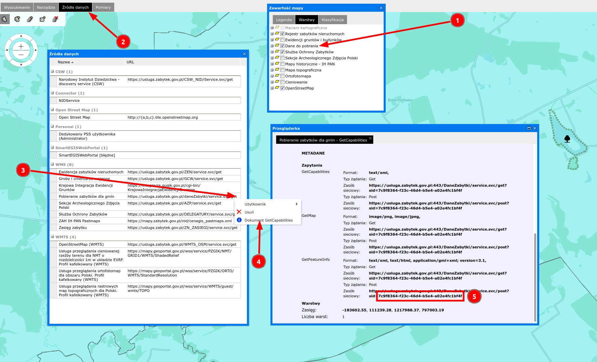

# 🏛️ nid2geoformats

`nid2geoformats` to aplikacja do pobierania, przetwarzania i aktualizacji danych przestrzennych udostępnianych przez **Narodowy Instytut Dziedzictwa (NID)**.

## 🧭 1. Czym jest ten projekt?

To narzędzie służy do:

- seryjnego pobierania paczek ZIP z danymi przestrzennymi z serwera NID,
- konwersji danych do nowoczesnych formatów przestrzennych (GeoParquet, GeoPackage),
- tworzenia aktualnej listy dostępnych danych na podstawie punktów lokalizacyjnych poszczególnych jednostek administracyjnych
- testowania poprawności połączenia z serwerem WMS NID.

Projekt może być wykorzystywany zarówno jako **program z linii poleceń (CLI)**, jak i **biblioteka Python**.

---

## 🧩 2. Z jakich elementów składa się aplikacja?

### 📥 Pobieranie danych (`fetch`)

Moduł `fetcher` pobiera pliki ZIP zawierające dane przestrzenne NID z listy linków przekazywanych w pliku tekstowym.

### 🔄 Konwersja danych (`convert`)

Moduł `converter` przetwarza zawartość ZIP (SHP) do:

- `GeoParquet` (parquet z geometrią),
- `GeoPackage (GPKG)`.

### ⛁ Import danych do bazy danych (`importer`)

Moduł `importer` przetwarza i importuje zawartość ZIP (SHP) do:

- `PostGIS` (tabele utworzone w podanej bazie i schemacie)

### 🧾 Aktualizacja listy archiwów (`init`)

Moduł `initializer` generuje listę linków do ZIP-ów na podstawie listy jednostek administracyjnych w układzie współrzędnych PL-1992 (EPSG:2180).

### 🌐 Sprawdzanie serwera WMS (`wms-test`)

Testuje poprawność `session_id` do usługi WMS NID, zwraca status połączenia.

---

## 🛠️ 3. Sposoby wykorzystania

### ✅ CLI – tryb wiersza poleceń

```bash

# Pobieranie danych ZIP z listy
python main.py fetch --input archiwa_do_pobrania.tsv --outdir data/raw

# Konwersja danych do formatu geopackage
python main.py convert --indir data/raw --outdir data/processed --format gpkg

# Konwersja danych do formatu geoparquet
python main.py convert --indir data/raw --outdir data/processed --format parquet

# Import danych do bazy danych PostGIS
python main.py postgis --indir data/raw --password super-tajne-hasło --host 127.0.0.1 --port 5432 --user qgisowiec --password sOOp3rT@Yneh4su0 --database dane_gis --schema zabytki

# Test połączenia z serwerem
python main.py wms-test --session 85dcc7d0-3458-4b78-a1bb-ed65b5513ee6

# Inicjalizacja listy ZIP z listy jednostek administracyjnych
python main.py init --input jednostki_do_pobrania.tsv --output archiwa_do_pobrania_nowe.tsv --session 85dcc7d0-3458-4b78-a1bb-ed65b5513ee6

```

### ✅ Python – jako biblioteka

3.1. pobieranie danych w formacie `geoparquet`

```python
from nid2geoformats.fetcher import fetch_archives
from nid2geoformats.converter import convert_data

fetch_archives("archiwa_do_pobrania.tsv", "data/raw")
convert_data("data/raw", "data/processed", "parquet")
```

3.2. pobieranie danych w formacie `geopackage`

```python
from nid2geoformats.fetcher import fetch_archives
from nid2geoformats.converter import convert_data

fetch_archives("archiwa_do_pobrania.tsv", "data/raw")
convert_data("data/raw", "data/processed", "gpkg")
```

3.3. import danych do bazy `postgis`

```python
from nid2geoformats.fetcher import fetch_archives
from nid2geoformats.importer import to_postgis

fetch_archives("archiwa_do_pobrania.tsv", "data/raw")
to_postgis("data/raw", '127.0.0.1', 5432, 'qgisowiec', 'sOOp3rT@Yneh4su0', 'dane_gis', 'zabytki')
```

3.4 aktualizacja danych wejściowych

```python
from nid2geoformats.initializer import initialize_archives_list

# Stała: identyfikator sesji WMS (należy uaktualniać w razie zmian po stronie NID)
SESSION_ID = "85dcc7d0-3458-4b78-a1bb-ed65b5513ee6"

initialize_archives_list(SESSION_ID, "jednostki_do_pobrania.tsv", "archiwa_do_pobrania_nowe.tsv")
```

---

## 📦 4. Wymagania (requirements)

```txt
requests
pandas
geopandas
tqdm
pyarrow
dotenv
sqlalchemy
psycopg2
```

Zainstaluj za pomocą:

```bash
pip install -r requirements.txt
```

---

## 📦 5. Przydatne wskazówki

### Plik konfiguracyjny `.env`

W celu usprawnienia importowania danych do bazy danych PostGIS możliwe jest stworzenie w głównym katalogu aplikacji (na poziomie pliku `main.py`) dodatkowego pliku `.env`, z którego zostaną odczytane parametry połączenia z bazą danych PostgreSQL z PostGIS.
Plik powinien być sformatowany w następujący sposób:

```text
PGHOST=127.0.0.1
PGPORT=5432
PGUSER=qgisowiec
PGDATABASE=dane_gis
PGSCHEMA=zabytki
PGPASSWORD=sOOp3rT@Yneh4su0
```

### Pobranie identyfikatora sesji dla serwisu usluga.zabytek.gov.pl

W przypadku gdy zapisany w aplikacji klucz nie działa, można go samodzielnie odczytać z serwisu [https://usluga.zabytek.gov.pl/nid/](https://usluga.zabytek.gov.pl/nid/). W celu pozyskania identyfikatora sesji należy:

(1) włączyć warstwę `Dane do pobrania`
(2) przejść do panelu `Źródła danych` i wybrać pierwszą ikonkę (`Pokaż zdefiniowane źródła danych`)
(3) rozwinąć listę na końcu wiersza `Pobieranie zabytków dla gmin`
(4) otworzyć `Dokument GetCapabilities`
(5) skopiować wartość z parametru `sid=WARTOŚĆ_KTÓRA_JEST_NAM_POTRZEBNA`
(6) zamienić na nową wartość stałej SESSION_ID w pliku `main.py`



---

## 🧾 6. Licencjonowanie danych źródłowych

Korzystając z danych akceptujesz warunki/komunikaty opisane na [stronie NID](https://mapy.zabytek.gov.pl/dane/notaPrawna.html)

Wszystkie dane zamieszczane w katalogu [dane.gov.pl](https://dane.gov.pl/) pochodzące z [Narodowego Instytutu Dziedzictwa](https://dane.gov.pl/pl/institution/64,narodowy-instytut-dziedzictwa) udostęniane są na licencji [CC BY 4.0](https://creativecommons.org/licenses/by/4.0/legalcode.pl)

Udostępnianie otwartych danych reguluje ustawa z dnia 11 sierpnia 2021 r. o otwartych danych i ponownym wykorzystywaniu informacji sektora publicznego ([Dz. U. z 2023 r. poz. 1524](https://dziennikustaw.gov.pl/DU/2021/1641)).

---

## 📚 7. Więcej informacji

Szczegółowy opis działania oraz przykłady wykorzystania aplikacji znajdziesz na blogu:

👉 [GeoInfor: o GIS, informacji i mapach](https://geoinfor.pl/)

---

🛠 Projekt rozwijany przez [Jakuba Bobrowskiego](https://www.linkedin.com/in/jakubbobrowski/) od lipca 2025.
